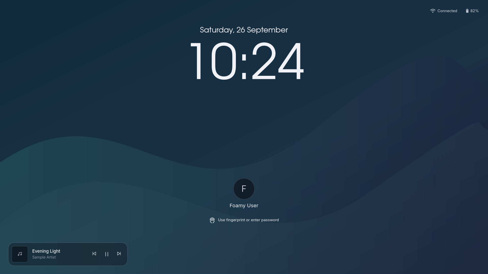

# Foamy Lock

A lock screen for Omarchy Quattro with a large clock, account name and avatar,
password and fingerprint authentication, network and battery status, and media
controls. It uses Omarchy's wallpaper and authentication services.



The screenshot uses synthetic account and media details and a neutral wallpaper.

## Install

Requires Omarchy 4.5 (checked against 4.5.0), Omarchy's Quickshell build and the existing
`/etc/pam.d/omarchy-lock-password` service. Fingerprint unlock also requires
Omarchy's fingerprint setup and an enrolled fingerprint. The plugin does not
install or change PAM configuration. The layout uses Adwaita Sans, URW Gothic,
and JetBrainsMono Nerd Font for the intended typography and status icons. When one
is missing, text falls back to the system sans-serif font and icons to the Omarchy
font. A theme that styles the stock lock (`[lock]` colours in `shell.toml`: `text`,
`placeholder`, `background`, `border`, `selection`, `text-error`, `border-error`)
recolours the glass; without those entries the lock keeps its white-on-glass look.

Artwork, the avatar thumbnail and background pictures additionally use ImageMagick
7 and Bubblewrap with unprivileged namespaces and seccomp support. They are
prepared by the plugin's
bundled helper, `bin/<arch>/foamy-lock-helper` (static binaries for x86-64 and
AArch64 Linux; no Python or other runtime). Remote artwork over HTTPS also needs a
CPU with AES and carry-less multiplication instructions (on x86-64 also AVX2, BMI2
and ADX: Intel Broadwell, AMD Zen or newer; on AArch64 the ARMv8 crypto extensions,
so not a Raspberry Pi 4); without them remote artwork reports `https-unsupported`.
If the helper or its sandbox cannot run, the music icon (or the account initial) is
shown. Artwork has no unsandboxed decoding fallback, and authentication depends on
neither. The same helper also finds the current wallpaper (see Wallpaper); on a CPU
without a helper binary the lock shows the plain themed background.

Install while your session is unlocked:

```sh
omarchy plugin add https://github.com/foamrider/foamy-lock.git
```

If another custom lock plugin is enabled, answer **No** to the enable prompt and
replace its entry with `foamy.lock` in `~/.config/omarchy/shell.json` as shown below.
Otherwise, you can enable Foamy Lock at the prompt; Omarchy disables the stock
lock service automatically. Keep exactly one lock service active, and keep
`omarchy.lock` in `disabledPlugins`. Preserve all unrelated entries and settings.

If both lock services end up loaded anyway, `omarchy-shell lock status` reports
`"conflict": true` with `conflictReasons` (`stock-lock-enabled`: `omarchy.lock` is
missing from `disabledPlugins`; `lock-target-shared`: another handler also answers
`lock`), and the shell log has a warning. On Omarchy 4.5 Foamy Lock keeps the
`lock` IPC target answered by itself, so the lock request and the pre-suspend status
check always reach the same lock screen. `omarchy-shell foamy.lock status` returns
the same status from a target only this plugin uses.

Apply the initial switch with `omarchy restart shell` **while unlocked**. Lock
normally with `omarchy system lock`. Restarting the shell while locked can leave
the compositor showing its lock-screen recovery screen.

## Settings

Settings belong directly on the plugin entry in the `plugins` array of
`~/.config/omarchy/shell.json`, not inside a separate `config` object. This fragment
shows the defaults; merge it into your existing file instead of replacing it:

```json
{
  "version": 1,
  "plugins": [
    {
      "id": "foamy.lock",
      "timeFormat": "24h",
      "showUserInfo": true,
      "showMedia": true,
      "showBrowserMedia": false,
      "showArtwork": true,
      "artworkHosts": [],
      "artworkFileRoots": [],
      "blankAfterSec": 30
    }
  ],
  "disabledPlugins": ["omarchy.lock"]
}
```

| Setting | Default | Values and effect |
| --- | --- | --- |
| `timeFormat` | `"24h"` | `"24h"` or `"12h"`; 12-hour time includes AM/PM. The date uses the session locale. |
| `showUserInfo` | `true` | Show the account name and avatar. Set `false` to hide both. |
| `showMedia` | `true` | Show available MPRIS media and transport controls. Set `false` to hide them. |
| `showBrowserMedia` | `false` | Also show media from web browsers (Firefox, Chromium, Chrome, Brave, Zen and others). Browsers report the page or tab title as the track title, so it stays off the lock screen unless you set `true`. |
| `showArtwork` | `true` | Prepare permitted artwork while unlocked. Set `false` to always show the music icon; titles and controls remain available. |
| `artworkHosts` | `[]` | Opt in to HTTPS artwork from at most 32 exact lowercase DNS hostnames, such as `images.example.com`. No wildcards, URL schemes, IP literals, or ports. Empty disables all remote artwork. |
| `artworkFileRoots` | `[]` | Additional permitted local artwork directories, up to 14 absolute paths. `$XDG_CACHE_HOME` (or `~/.cache`) and `$XDG_RUNTIME_DIR` are included automatically. Values must be actual absolute paths, without `..`; `~` and environment variables are not expanded. |
| `blankAfterSec` | `30` | Integer from 1 to 2147483 seconds of lock-screen inactivity before blanking the display and keyboard backlight. `null` disables this timer. This does not unlock or suspend the computer. |

All settings are optional. Changes are watched live. Invalid setting values,
duplicate `foamy.lock` entries, or a file this plugin cannot read produce a warning
and retain the last valid preferences (the defaults on startup). Correct the file to
apply new settings.

A `shell.json` that Omarchy itself cannot use (invalid JSON, or no `"version": 1`)
is different: Omarchy then falls back to its default configuration, in which Foamy
Lock is not enabled and the stock lock is. Until the file is fixed, the stock lock
screen is used. If this happens while the screen is locked (for example after
editing the file over SSH), the session stays locked: Hyprland keeps the lock, and
the stock lock's stranded-lock recovery takes over. Nothing in this path unlocks
the session.

The automatic **lock** timeout remains Omarchy's `idle.lock` setting. This plugin's
`blankAfterSec` only controls blanking after a lock has been requested. The normal
password check and wake handling are preserved; a running password check pauses
the blanking timer. Fingerprint waiting does not prevent blanking.

The plugin reads the same `~/.config/omarchy/shell.json` and
`~/.local/state/omarchy/current/background` paths as Omarchy. It stores its derived
avatar thumbnail at `$XDG_CACHE_HOME/omarchy/foamy.lock/avatar.png`, falling back to
`~/.cache/omarchy/foamy.lock/avatar.png`.

## Look: presets, layout and background

The lock screen is made of eight elements (date, clock, account, password field,
media, status, calendar, weather) on a background. A preset chooses where each element sits and how
it looks. `layout` changes single elements, and `background` and `glass` change
what is behind them. All four keys sit on the same `foamy.lock` entry and are
optional; without them the lock looks exactly as in 1.2.0.

```json
{
  "id": "foamy.lock",
  "preset": "corner",
  "layout": { "media": { "zone": "bottom-center" }, "status": { "hidden": true } },
  "background": { "source": "picture", "path": "/home/you/Pictures/lake.jpg", "blur": 0.4, "dim": 0.3 },
  "glass": { "opacity": 0.6 }
}
```

| Preset | |
| --- | --- |
| `foamy` | The default: the date and a large clock at the top, the account and field below the middle, media bottom left, status top right. |
| `corner` | The date and a bold clock bottom left; the account chip and an underline field bottom right. |
| `editorial` | The date, clock, account and field stacked on the left, in the middle of the screen. |
| `zen` | Only the field, centred, over a blurred and dimmed wallpaper. |
| `dock` | A band along the bottom: a small clock, the field box and the short date. |
| `island` | The time and date in a black pill at the top; the field in the middle. |
| `split` | A solid panel on the left with the date, a bold clock, your name and the field; the wallpaper on the right. |
| `sheet` | A frosted panel on the right with the avatar, clock, date and field. |
| `card` | A glass card in the middle: avatar, small clock, date and field. |
| `cinema` | Black bars: the time and date in the top one, an underline field in the bottom one. |
| `poster` | Huge hours over minutes (the minutes in the accent) on the left; the field bottom left. |
| `analog` | An analogue clock, the date and the field in the middle. |
| `flip` | Flip-card hours and minutes over the date and field. |
| `ring` | The time inside a ring that fills with the minutes of the hour. |
| `calendar` | The date, a bold clock and the field on the left; this month's calendar on the right. |
| `terminal` | A console login on black: mono clock, your name and a `Password:` prompt. |
| `neon` | An outlined clock and accent edges inside a glowing accent frame, over a dark wallpaper. |
| `system` | The clock and field beside a panel with uptime, memory, load and battery. |
| `music` | Now playing with large artwork in the middle, the field below it. |
| `aurora` | Soft bands of the theme's colours drifting behind the clock and field. |
| `rain` | Thin streaks falling behind a card with a mono clock and a terminal field. |
| `constellation` | A star field; each typed character lights the next star of a figure. |
| `dotmatrix` | A dot-matrix clock and dotted field inside a dark bezel. |
| `flat` | The clock, date and field in the middle, on solid surfaces without edges. |
| `frosted` | The same on glass over a strongly blurred wallpaper (blur needs GPU rendering). |
| `fluent` | A bold clock and a greeting card with accent edges. |

Presets from `dock` on are inspired by the layouts of
[Lock Designs](https://github.com/KamradSmeshnyavy/omarchy-lock-designs) (MIT),
rebuilt from the elements, decorations and backgrounds here; no code is shared.
The editor's thumbnails are in `previews/presets` (`tests/harness.sh thumbnails`).

**Layout.** Each element takes `zone`, `style`, `order` and `hidden`, and the
optional `scale`, `opacity`, `offset`, `glass` and `screens` (below the styles):

- **`zone`.** One of `top-start`, `top-center`, `top-end`, `middle-start`,
  `middle-center`, `middle-end`, `bottom-start`, `bottom-center` and
  `bottom-end`. Start and end mean left and right, and swap in right-to-left
  languages.
- **`order`.** Elements in one zone stack by `order`, an integer from -99 to 99.
- **On narrow screens** the bottom corners are centred and stacked under the
  field, and when both middle sides are used the end side moves under the
  start side.
- **The calendar** is its own element rather than a clock style, so it can sit
  beside any clock; it keeps one size (six weeks) whatever the month.
- **The `system` panel** reads `/proc/uptime`, `/proc/loadavg` and
  `/proc/meminfo` every five seconds, only while it is shown and the display
  is on; nothing is read or kept otherwise. With `items`, each file is read
  only while an item shows it, in any style.
- **The weather** comes from [Foamy Weather](https://github.com/foamrider/foamy-weather)
  (its `current()` call; see below). No built-in preset shows it.

| Element | Styles |
| --- | --- |
| `date` | `long` (default), `caps`, `short` (abbreviated, "Sat 7 Nov"), `serif` (a large serif weekday over the spaced date), `numeric` (the locale's short date), `stacked` (a large day number beside the month and weekday), `week` (the ISO week number and the date) |
| `clock` | `thin` (default), `bold`, `stacked` (hours over minutes), `mono` (the Omarchy font), `outline`, `dots` (a dot-matrix face), `flip` (two cards), `analog`, `small` (one line, for a bar or card), `poster` (huge hours over accent minutes), `ring` (the time in a ring that fills over the hour) |
| `account` | `avatar` (default), `chip`, `name` (the name alone) |
| `password` | `pill` (default), `underline`, `box` (an always-visible glass box with the arrow), `dots` (no surface), `terminal` (a "Password:" prompt in the mono font), `card` (a greeting above the field) |
| `media` | `card` (default), `line`, `pill` (thumbnail, title and play/pause), `art` (large artwork with the controls below) |
| `status` | `text` (default), `icons`, `pill` (icons and the battery level in one pill), `system` (a panel with uptime, memory, load and the battery, or the network without one) |
| `calendar` | `card` (default; this month on glass, today ringed in the accent), `plain`, `week` (this week's seven days on a glass strip), `mini` (a smaller month without a card). Hidden unless a preset or `hidden: false` shows it. |
| `weather` | `compact` (default; an icon and the temperature), `pill` (one line in a glass pill), `detailed` (a glass card). Hidden unless `hidden: false` shows it, and only while Foamy Weather has a report. |

**Element keys of their own.** Optional, and accepted only on their element:

| Key | Values | Default | Meaning |
| --- | --- | --- | --- |
| `password.reveal` | `always`, `typing` | `always` | `typing` hides the `underline`, `box`, `terminal` and `card` field's surface, line, prompt, greeting and arrow until you type or a failure or check shows; the unlock hint and the fingerprint notice stay, and the field is live and keeps its place. `pill` and `dots` already show only the hint, so they ignore it. |
| `status.items` | An ordered list of `network`, `battery`, `volume`, `bluetooth`, `keyboard`, `uptime`, `load`, `memory`, each at most once | the style's own (network and battery; the `system` panel's four rows) | What the status shows, in that order, in any style. An item whose source has nothing (no battery, no PipeWire sink, no Bluetooth adapter) is left out. The volume (the default sink, PipeWire), Bluetooth (on or off and connected devices) and keyboard layout (Hyprland's active layout, read with `hyprctl -j devices`; nothing is switched) are read only while their item shows. A line wider than the centre column wraps. |
| `weather.details` | `temperature`, `full` | `temperature` | `full` adds the condition and today's high and low. |
| `weather.location` | `true`, `false` | `false` | Shows the forecast's place name. Off by default: anyone can see a lock screen. |

**Weather.** While the lock or the preview shows a look with the weather, the
lock asks Foamy Weather (`foamy.weather current`, in-process on Omarchy 4.5)
when it opens and then every 15 minutes while the display is on. Nothing is
called when no `foamy.weather` target is loaded; a starting service is asked
again up to three times, 10 s apart. A reply is shown only when every field
checks out (numbers in range, one-line text within the documented lengths, no
control or direction-override characters), as plain text, and only while it
is under three hours old; otherwise, and for an older Foamy Weather without
`current()`, the weather is hidden. `lock status` reports its state, never the
place.

**Size, finish and free placement.** Every key is optional; without them an
element draws exactly as its preset says.

| Key | Values | Default | Meaning |
| --- | --- | --- | --- |
| `scale` | 0.5 to 2 in steps of 0.05; the field 0.85 to 1.5 | 1 | The element's size. A scaled date or clock in a centre column widens with it, up to the screen less its margins. |
| `opacity` | 0.3 to 1; the field 0.7 to 1 | 1 | The whole element's opacity. |
| `offset` | `{ "x": …, "y": … }`, both required, each -0.5 to 0.5 | none | A move from where the zone puts it, as a fraction of the screen's width (`x`) and height (`y`), so one look fits every screen size. `x` mirrors in right-to-left languages, like start and end. The rest of the zone's stack stays where it was, and decorations keep fitting the zones, not the moved element. |
| `glass` | 0 to 1; the field 0.08 to 1 | the look's `glass.opacity` | The opacity of the element's own glass surface. Only these styles have one: the clock's `analog` and `ring`, the account `chip`, the field's `pill`, `box` and `card`, the media `card`, `pill` and `art`, the status `pill` and `system`, the calendar `card` and `week`, and the weather `pill` and `detailed`; the element's other styles ignore it. The date has no glass and rejects the key. |
| `screens` | `all`, `primary` | `all` | `primary` shows the element only on the monitor that receives your keystrokes (or on every monitor until one does). For the date, clock, media, status, calendar and weather; the account and the field already follow that monitor and reject the key. |

```json
"layout": { "clock": { "scale": 1.25, "offset": { "x": -0.1, "y": 0.02 } }, "media": { "glass": 0.4, "screens": "primary" } }
```

Each password style has a fixed size, so the field never moves while you type.
Every style reads the same with CPU rendering, except the artwork: the media
pill and art then show it as a plain square instead of a round or rounded one,
and the card's thumbnail still needs GPU rendering. Only the drawn backgrounds
move (see below).

The password field can't be hidden, and it stays in the middle or bottom row.
`showUserInfo: false` and `showMedia: false` still hide the account and media
whatever the layout says. Artwork is prepared only while a media style
that shows it (`card`, `pill` or `art`) is shown.

**Background.** These keys set what's behind the elements:

- **`source`.** One of:
  - `omarchy` (default; **Wallpaper** in Lock Studio): the current Omarchy
    wallpaper, as before;
  - `picture` (**Custom image** in Lock Studio): the file in `path`, an absolute `.png`, `.jpg` or `.webp`, or a
    video (`.mp4`, `.m4v`, `.mov`, `.mkv`, `.webm`; see Video below);
  - `theme`: the theme's background colour;
  - `black`;
  - `aurora`: soft bands of the theme accent, green and cyan drifting slowly;
  - `rain`: thin accent streaks falling at different speeds;
  - `constellation`: stars and one figure whose stars light up as you type.

  The last three are drawn in the theme's colours over its background. They
  move only while the lock screen is shown, the display is on, Omarchy's
  animations are on and the GPU renders; otherwise (reduced motion, CPU
  rendering, a blanked display) they hold a still frame.
- **`decor`.** A shape over the background and behind the elements, fitted to
  the zones it belongs to (it follows them to narrow screens and mirrors in
  right-to-left languages). It is background: it never covers an element.
  - `none` (default);
  - `split`: a solid panel on the start side, as wide as its column needs
    (at least 38%), with an accent edge; it fills a narrow screen;
  - `sheet`: a frosted panel on the end side;
  - `cinema`: black bars at the top and bottom;
  - `strip`: a band behind the bottom row;
  - `island`: a pill around the top-center zone;
  - `frame`: a border inset from the edges: a glow with the `accent` glass
    tint, otherwise a dark bezel;
  - `card`: a glass card behind the middle-center zone.

  With `cinema` and `strip` the bottom-center stack sits at the bottom edge,
  in the band, instead of at 65% height. The frosting behind `sheet` and
  `card` needs GPU rendering.
- **`blur`.** From 0 to 1.
- **`dim`.** The darkening scrim, from 0 to 0.9; the default is 0.25.
- **Picture preparation.** A custom image is decoded, cropped to the screen and
  blurred by the bundled helper in its sandbox while you are unlocked. The
  original file never reaches the lock screen.
- **Blur of the Omarchy wallpaper** needs GPU rendering. With CPU rendering
  the wallpaper stays sharp, and the dim still applies.
- **Underline field.** It has no surface of its own, so it keeps at least
  0.15 dim behind it.
- **`motion`.** For a video (a `picture` that is a video, or an Omarchy
  wallpaper that is one): `still` (default) or `play`.
- **`pauseOnBattery`.** `true` (default) or `false`: whether a playing video
  holds still on battery.

**Video.** A video background shows its first frame, made by the helper in
its sandbox (an Omarchy video wallpaper keeps Omarchy's own still frame).
With `motion: "play"` it plays a clip that Lock Studio converted for this
file and the largest screen's native size (its Convert button, see Lock
Studio); the lock itself never converts, and without such a clip it shows
the still frame. It plays only with GPU rendering, muted and looping, and
holds its frame while the display is blanked, motion is reduced, the lock
isn't shown or (with `pauseOnBattery`) the laptop is on battery. After the
first playback error or 2 s without a new frame it shows the still frame for
the rest of that lock (`video.failure` in `status`). Play is experimental:
the clip is decoded inside the shell, so a decoder crash would take the lock
screen with it and leave the session locked behind a dead screen. Then log
in on a text console (Ctrl+Alt+F3) and run `loginctl unlock-session`.

Conversion limits: the input at most 2 GiB, MP4/MOV, MKV or WebM with H.264,
HEVC, VP8, VP9 or AV1 video up to 7680 x 4320; the first 60 s are used, at
the source's frame rate up to 30 fps; the output is H.264 at the screen's
native size up to 3840 x 2160, at most 150 MiB, without sound or metadata.
The helper decodes the file and encodes the clip in two separate sandboxes,
at idle priority with up to 16 threads (one conversion at a time, cancel any
time, 10 minutes at most). It keeps at most three clips in
`/omarchy/foamy.lock/video/`, the oldest evicted.

**Glass.** `opacity` (0 to 1, default 1) scales the transparency of the glass
behind the media card, the account chip, the field and the decorations.
`tint` is `none` (default, white glass), `accent` (the theme accent on the
edges, and the outline clock drawn in it) or `solid` (opaque surfaces without
edges).

**Mistakes and safety.** A mistake in these keys, such as an unknown name or a
value out of range, leaves the previous look in place and shows up as
`lookError` in `omarchy-shell foamy.lock status`. It never resets the other
settings, and a mistake in the other settings never resets the look. Each time
the lock screen is shown, it checks what each screen draws: the field must be
on the screen, its top below the top third, and not covered by another
element; every element must be on the screen; and elements in different zones,
or moved with `offset`, must not overlap (elements stacked in one zone may, as
the clocks pull up into the date). If not, that screen shows the `foamy` preset
instead, and if even that doesn't fit, only the field, centred. `status`
reports this as `layoutError` and `fallbackPreset`. The codes are `password-missing`,
`password-offscreen`, `password-high`, `password-overlap`, `element-offscreen`
and `element-overlap`.

**Several monitors.** Every monitor shows the same layout. The account and the
field's surround show only on the monitor that receives your keystrokes, or on
every monitor until one does. A password field that accepts typing stays on
every monitor, so a keystroke is never lost.

**Previewing a preset.** `omarchy-shell foamy.lock previewPreset corner` opens
the preview overlay with a preset without saving anything. `omarchy-shell lock
preview` shows your saved look.

Editors use three more calls on the same target: `catalog` (version 3) lists the elements, zones,
styles, the element keys with their limits (`elementLimits`: ranges, glass styles, `screens`, and each element's own keys under `options` with their values and defaults; `elementKeysFor` names every key an element takes), the status items, whether Foamy Weather answers (`weather`), presets (with their thumbnails), background sources, decorations, glass tints and the saved look; `previewLook '<json>'` previews an unsaved look;
`saveLook '<json>'` saves one. Both take the look keys above, validated by the same
rules; `saveLook` replaces only those keys in the `foamy.lock` entry and writes through
Omarchy's own settings path, which keeps a symlinked `shell.json` a symlink.
`saveLook` also takes `userPreset`, the id of the user preset the look came from
(omitted, the link is removed). A `shell.json` that Omarchy can't read is never
written: the answer is then `write-failed`. A JSON argument (`previewLook`, `saveLook`,
`savePreset`) over 64 KiB is refused before it is parsed: `invalid: argument over 65536 bytes`.

**User presets.** `userPresets` in the `foamy.lock` entry holds your own presets,
newest first: `[{"id": "u-…", "name": "Foamy (mine)", "look": {"preset": …,
"layout": …, "background": …, "glass": …}}]`, at most 50 and 256 KiB (items past either are
counted as skipped, not read). Each item is
checked on its own: an invalid one is skipped (`status` and `catalog` count it in
`userPresetsInvalid`), and nothing in the list can change the settings or the look.
`catalog` lists them (`userPresets`, with the built-in preset's thumbnail), and
`previewPreset user:<id>` previews one. Editors change one at a time:
`savePreset '<json>'` (`{id, name, look}`; the id is the caller's own, a new id goes
first, a known one is updated), `renamePreset <id> <name>` and `deletePreset <id>`
(which also drops the look's link to it). They answer like `saveLook`, plus `full`,
`too-large` and `unknown-preset`; a repeated call answers `unchanged`.

## Lock Studio

Lock Studio is a desktop app for designing the lock screen: pick a preset, drag
the elements around a live copy of the lock screen, and adjust each one (style, size,
opacity, glass, position, which screens show it), the background and the glass.
It runs the lock screen's own drawing code in its own window, so what you see is what
the lock screen shows, and it saves through Foamy Lock (`saveLook`), never by writing
`shell.json` itself.

Add it to the app launcher once:

```sh
~/.config/omarchy/plugins/foamy.lock/bin/$HOSTTYPE/foamy-lock-helper studio install
```

Then open **Lock Studio** from the launcher, or run the same helper with
`studio open` (or just `studio`). Opening it again brings the open window to the
front. `studio uninstall` removes the launcher entry.

**Editing.** Drag an element on the canvas; it snaps to where it would sit in each
zone, to the screen's centre lines, to the other elements' edges and to a grid. The
library on the left lists every element: drag a hidden one onto the canvas to show
it, or drag one from the canvas back to the library to hide it. The preset is the
library's first row. Click beside the lock screen image (or press Esc) to edit the look as
a whole: background, glass and dim. Everything the pointer does, the keyboard does
too. The screen menu lists each connected screen with its native size and scale
(the canvas lays it out at its logical size, as the lock screen does) and two reference
sizes (1280 × 720, 1920 × 1080); a problem on a connected screen (an
element off screen, two elements overlapping, the password field covered or too
high) is listed under the canvas and stops Apply, one only at a reference size is
a warning.

**Element options.** The inspector also sets each element's own keys: the
password field's **Show the field** (Always, or While typing for the styles that
draw a surface), the status's items (a checklist: tick what it shows, reorder by
the grip or with Alt+Up and Alt+Down; a new style starts from its own contents),
and the weather's details and place name (off by default). The canvas shows sample
volume, Bluetooth, keyboard layout and weather, never yours, and the problem check
uses the widest samples. When the lock screen can't reach Foamy Weather, the
Weather row says **Needs Foamy Weather**.

**A video background.** "Choose picture or video…" offers MP4, MOV, MKV and WebM
videos too. For a video (or an Omarchy wallpaper that is one) the background page
shows a card: its first frame, the facts ("4 min 12 s · 3840 × 2160 · HEVC ·
412 MB"), what converting makes of it ("Uses the first 60 s, scaled to 3440 × 1440,
30 fps, no sound"), the estimated time and **Convert**. Nothing converts until you
press it; a progress bar with **Cancel** follows, then "Ready · 72 MB". Over a limit
(see Video) the card says which, and Convert is disabled. Once there is a clip,
**Motion** can be **Play (experimental)**, with **Pause on battery** (on by default).
The canvas shows the first frame; Preview full screen plays the clip as the lock
screen would.

| Keys | |
| --- | --- |
| Arrows | Move one grid step |
| Shift+arrows | Move one pixel |
| Ctrl+arrows | Move to the next zone |
| `+` / `-` | Larger or smaller |
| Delete / Insert | Hide or show the element |
| `[` / `]` | Previous or next element |
| Esc | Clear the selection (the look as a whole) |
| Shift while dragging | Drag without snapping |
| Alt while dragging | Drag along one axis |
| Ctrl+Z / Ctrl+Shift+Z | Undo / redo |
| Tab, F6 | Next control, next pane |
| `?` | All shortcuts |
| Ctrl+Q | Quit |

**Saving.**
- **Your draft** (the look and its undo steps) is kept in
  `~/.local/state/foamy-lock/studio-draft.json` a moment after each edit, so closing
  the app or a crash loses nothing. When you open the app with a draft the lock
  screen doesn't have, it asks: **Continue editing**, or **Start from saved** (which deletes
  the draft).
- **Apply to lock screen** saves the look through the running Foamy Lock. The header
  says how it went: applied, refused (with the reason), the screen is locked, the shell
  isn't running or didn't answer (it is asked once more; if it still doesn't
  answer, the look may or may not be saved). Anything but a save keeps the draft.
  While the lock screen doesn't have your changes, the header says **Unsaved changes**.
- **Your presets** come first in the preset menu, then the built-in ones. Applying
  changes made on a built-in preset asks for a name (prefilled "Foamy (mine)"), saves
  your preset and applies it; **Apply without saving a preset** applies the look as it
  is. Applying changes on one of your presets updates it. **Save as new…**, rename and
  delete (asked first) are in the menu. They live in `shell.json` with the lock
  screen's other settings (see User presets above).
- **Reset** goes back to the last saved look, or to the preset without your changes;
  either can be undone.
- **Preview full screen** shows the look on the lock screen's own preview overlay without
  saving; click or press any key to close it.
- **Quitting** with changes the lock screen doesn't have asks: **Apply and quit**,
  **Discard** (deletes the draft) or **Cancel**.

**Privacy.** The canvas uses a sample account and a sample track, never your name,
avatar or what is playing. The clock, network and battery are real. The full-screen
preview is the lock screen's own and shows your real account and media. Your picture
and name on the lock screen come from your account; the first tip in the app says to
set them with Mugshot (and how to install it). The app remembers the last tip you saw in
`~/.local/state/foamy-lock/studio-state.json`.

Screenshots of the app will follow.

## Fingerprint recovery

Temporary reader or daemon errors are retried with increasing delays. If the
reader remains unreachable, the lock shows "Fingerprint reader unavailable";
password unlock remains available. Temporary availability-check errors do not
turn fingerprint unlock off for the rest of the lock session.

Some readers also need a system-level `fprintd` restart after resume. This plugin
does not install that hook or change system services. Recovery follows
[Omarchy PR #7158](https://github.com/omacom/omarchy/pull/7158), including retries
while the daemon restarts. Device errors within two seconds of a finger prompt
also back off; ordinary mismatches keep the fast retry. Display blanking pauses
new attempts, lets an active attempt finish, and preserves pending retry delays.
Input, an arriving display, or resume detection restarts the loop. Status includes
`fingerprintUnavailable` and `fingerprintPaused`.

## Wallpaper

Static wallpapers are preloaded at each display size and refreshed when the
selected file changes, including replacement at the same path. Video wallpapers
use a cached still frame: the poster of the bundled helper's sandboxed `video-probe`
(the same probe and cache as a video background, never Omarchy's `poster.sh`, whose
ffmpegthumbnailer runs outside any sandbox). Unless a look plays it, Foamy Lock
does not play video. If the helper is missing or can't read the video, it uses the
plain themed background. Wallpaper failures do not block
authentication; `lock status` reports them in `wallpaperError`.

The bundled helper (`foamy-lock-helper wallpaper <link>`, at most 2 seconds) resolves
`~/.local/state/omarchy/current/background` like `readlink -f` and stats the file it
ends at; no shell tools such as `stat` or `jq` are involved. A change of the file's
size, modification or change time, or another file in its place, reloads the image;
an unchanged file keeps the cached one. A dangling link, a missing file, a directory
or another non-regular file leaves the plain themed background with
`wallpaperError: "wallpaper-unavailable"`. `helper-unavailable` means there is no
helper binary for this CPU; the probe is then not run again until the shell reloads.

## Account name and avatar

Open **About Me** from the application launcher (the app is **Mugshot**, also
available as `mugshot`). It lets you set your account's display name and avatar.
Foamy Lock reads those account details; there is no separate name or image setting
in `shell.json`. Open the preview or lock again after saving to refresh them.

AccountsService supplies the display name and avatar when available. The passwd
entry's full name and `~/.face` are fallbacks; without a display name the login name
is shown, and without a usable image the avatar shows an initial. The picture
goes through the same sandboxed decoder as artwork (PNG, JPEG or WebP, up to
16 MiB and 4096 × 4096 pixels) and comes back as a 256 × 256 thumbnail, with a
10-second limit for the whole job. Only when Bubblewrap or ImageMagick is not
installed is the original picture shown instead; a picture the sandbox rejects or
times out on shows the initial, and `lock status` reports `avatarError`.

## Media and preview

Media controls use Quickshell's MPRIS integration directly and do not need Foamy
Media or a custom bar. A playing track with metadata takes priority; otherwise the
first player with track metadata is shown. Buttons follow the player's supported
transport actions. No controls appear when no player supplies metadata.

Privacy: anyone at the locked computer can read the shown title and artist and use
previous, play/pause and next. Transport control is deliberate: Omarchy's media keys
already work while locked (they are bound with `locked = true`), so the buttons add
no new capability, and nothing else is reachable from them. Browser players are
hidden by default (`showBrowserMedia`) because their "track title" is the page or
tab title. Set `showMedia: false` to show no media at all.

### Artwork safety and fallback

The view never loads the player's `trackArtUrl` directly. While unlocked, a
separate helper reads permitted artwork and decodes it in a Bubblewrap sandbox
without network, home-directory, session-bus, or desktop-socket access. It accepts
static PNG, JPEG, and WebP only. ImageMagick delegates and other image coders are
disabled, and the decoder cannot create subprocesses or additional namespaces.
The sandbox returns exactly 256 × 256 RGB pixels. The helper checks
their length and creates a minimal PNG without copying source metadata or source
compressed data. Only that thumbnail reaches the lock view.

Local sources must be `file:///` URLs to user-owned regular files below a
permitted directory. Symlink traversal below that directory, special files, and
parent traversal are rejected. For players that store covers elsewhere, add the
specific artwork directory to `artworkFileRoots`, rather than your whole home.

Remote artwork is off by default. Adding a hostname to `artworkHosts` allows
requests to that host while unlocked, which reveals your IP and request timing
to it. Every redirect must remain HTTPS on port 443 and use an allowed hostname.
DNS answers must be public addresses; connections are pinned to a checked IP
with normal hostname certificate verification. There are no cookies,
credentials, proxy-environment settings, or user curl configuration involved.

| Boundary | Limit |
| --- | --- |
| Input, including responses without a length header | 5 MiB |
| Source width and height | 4096 pixels each |
| Network operation, including DNS and redirects | 5 seconds; 2 redirects |
| Decoder | 256 MiB address space; 2 CPU seconds; 3 wall-clock seconds |
| Thumbnail | 256 × 256 RGB; approximately 193 KiB PNG |
| Cached thumbnails | 16 files, approximately 3 MiB total |
| Work | One job at a time; at most one start every 2 seconds |

These are upper bounds, not promises that every image within them can decode:
an image that needs more working memory falls back to the icon. The decoder
cannot spill its image cache to disk. Whole helper jobs have a 9-second limit.

On a lock request, outstanding artwork work is cancelled without delaying the
lock. No new helper jobs start while locking or locked. A track with a completed
thumbnail in this shell session's cache can show it; other tracks show the music
icon until unlocked. Cancellation cannot retract network packets already sent.
Preview follows the same policy as the current lock state.

The icon also appears during loading, for missing or rejected artwork, and on
helper or image-display errors. Stale results from cancelled tracks are ignored.
Failures are held for 60 seconds before a subsequent track/state change can retry;
there is no automatic retry loop. Disabling media or artwork cancels current work.

Generated thumbnails use a private directory at
`$XDG_CACHE_HOME/omarchy/foamy.lock/artwork` (or
`~/.cache/omarchy/foamy.lock/artwork`). They contain no embedded track names or
URLs. Old thumbnails are evicted automatically; interrupted staging files are
reclaimed by the next decoding job. A shell restart rebuilds its trusted cache
instead of treating existing disk images as validated. This protects against
untrusted media content; it does not isolate the shell from other malicious
processes already running as your Unix user.

```sh
omarchy-shell lock preview
omarchy-shell foamy.lock previewPreset zen   # a preset, not saved
omarchy-shell lock hidePreview
omarchy-shell lock status
```

Preview is a visual overlay, **not a secure lock**: a "Preview" banner says so, and
the password field shows no unlock hint. Click it or press any key to dismiss it;
for half a second after, it still takes the keyboard, so keys typed into it don't
reach the window below. A real lock request also closes it, and the preview calls
answer `locked` while the screen is locked. Preview
and status use your real account details; the README screenshot is generated
separately with synthetic data. Status includes effective settings, configuration
errors, lock state, and local account information. Do not share its output without
checking it for personal details.

Status also reports `artworkState` and a short `artworkError` code without
including artwork URLs. Sources outside `artworkHosts` or `artworkFileRoots` are
refused before any helper starts, and each error code is logged once until artwork
works again. `host-not-allowed` means remote artwork was not opted in;
`file-outside-roots` means the cover is outside the permitted directories.
`decoder-unavailable` means Bubblewrap or ImageMagick is missing; `decode-failed`
can indicate a rejected image, a resource limit, or unavailable sandbox support.
`helper-unavailable` means there is no helper binary for this CPU; artwork then
stays on the music icon and no helper is started again until the shell reloads.

### Background picture preparation

Background pictures (the look's `picture` source) are
prepared by the same helper and sandbox as artwork (`foamy-lock-helper artwork`
with the request `{"kind": "background", "path": "/absolute/path", "width": W, "height": H, "blur": B}`;
the full contract is at the top of `native/src/main.rs`). The path may be a symlink
or root-owned, like Omarchy's theme wallpapers, but must be a regular static PNG,
JPEG or WebP file. The sandbox returns exactly W × H RGB pixels, cover-scaled and
centre-cropped like Qt's `PreserveAspectCrop`; the helper checks their length and
writes a minimal PNG, so no source metadata or compressed data reaches the lock.
Blur 0 is none; otherwise it is a Gaussian with a sigma of B × min(W, H) / 40
pixels (27 px at full blur on a 1080-pixel-high screen), computed at a reduced
scale and scaled back up. Large JPEGs are decoded at a reduced scale that still
covers the screen.

| Boundary | Limit |
| --- | --- |
| Input | 32 MiB |
| Output (the screen in logical pixels) | 16 to 7680 wide, 16 to 4320 high |
| Source | 16384 pixels a side, under 64 megapixels |
| Decoder (P = W × H) | 768 MiB + 32 bytes × P address space (about 1.7 GiB at 7680 × 4320); 2 CPU seconds + 1 per started 3840 × 2160 of P (3 to 6); 1 more wall-clock second |
| Result | W × H RGB; a stored PNG of about W × H × 3 bytes (24 MiB at 3840 × 2160) |
| Cached backgrounds | 4 files, newest kept |

Very large screens on slow CPUs can reach the decoder or 9-second job limit
(`decode-timeout`, `job-timeout`). Results are kept in a private directory,
`$XDG_CACHE_HOME/omarchy/foamy.lock/background` (or
`~/.cache/omarchy/foamy.lock/background`), as `<sha256>.png`, under the same
ownership, permission, locking and staging rules as the artwork cache. Its own
error codes are `invalid-size` (width or height), `invalid-background-path` and
`background-missing`; a blur outside 0 to 1 is `invalid-request`.

## Validation

```sh
omarchy plugin validate .
/usr/lib/qt6/bin/qmllint Artwork.qml Service.qml LockView.qml elements/*.qml
node --test tests/*.test.cjs
python3 -I -B -m unittest discover -s tests -p artwork_test.py -v
FOAMY_HELPER='["bin/aarch64/foamy-lock-helper"]' python3 -I -B -m unittest discover -s tests -p artwork_test.py
python3 -I -B tests/artwork_runtime.py
bash tests/harness.sh render                  # --language no renders in Norwegian
bash tests/harness.sh parity                  # geometry against 1.2.0 (needs the git history)
bash tests/harness.sh layout                  # every preset, the style sweep and the placement cases (also: styles, placement alone)
bash tests/harness.sh runtime                 # service, PAM, fingerprint, wallpaper and IPC flows
bash tests/harness.sh thumbnails              # re-render previews/presets/*.png (480 × 270)
bash tests/harness.sh studio                  # Lock Studio offscreen, saving against a fake omarchy-shell (--language no, ar)
bash tests/kit-check.sh
```

The tests are Rust (`tests/harness`), Python 3 and Node (development only; the plugin does not need
them at runtime). `tests/plaintext.test.cjs` is a lint: every `Text` in the plugin's QML sets
`textFormat: Text.PlainText` (Text's default renders markup, so a file name like
`` would make Qt decode an image outside the sandbox); an exception needs an
entry with its reason in the test's `ALLOWED`. `artwork_test.py` runs the helper as a process: it checks the
request/reply contract, the exact Bubblewrap command line, environment, rlimits,
inherited descriptors, policy and seccomp program (through stand-in `bwrap` and
`magick` scripts in an outer Bubblewrap namespace), HTTPS against a local TLS
server, and the real sandbox. It also covers the `wallpaper` subcommand (link chains,
touches, rewrites and failures against `readlink -f`). The `background` job's request
checks, limits, PNG writer and a real-sandbox decode are Rust unit tests in `native/`
(run by `build-native.sh --test`). `FOAMY_HELPER` selects another
build; the aarch64 binary runs through qemu binfmt, which has no seccomp, so its
real-sandbox tests are skipped. The HTTPS tests use the helper's test-only `FOAMY_LOCK_TEST_RESOLVE`
and `FOAMY_LOCK_TEST_CONNECT` overrides (documented in `native/src/main.rs`; the
shell clears the helper's environment, so they never apply there).

### Rebuilding the helper

The helper's source is `native/` (Rust; its contract is the doc comment at the top
of `native/src/main.rs`), built with foamy-kit's tool, which needs rustup with the
toolchain in `rust-toolchain.toml`:

```sh
export CARGO_TARGET_DIR=~/.cache/foamy-native/foamy-lock   # never a target/ inside the plugin
~/GitHub/Personal/foamy-kit/tools/build-native.sh . --test  # fmt, clippy, unit tests
~/GitHub/Personal/foamy-kit/tools/build-native.sh .         # both arches into bin/, writes native/native.pin
~/GitHub/Personal/foamy-kit/tools/build-native.sh . --verify
```

Commit the binaries with `native/native.pin`; `tests/kit-check.sh` refuses
binaries that are stale or don't match the pin.

Shared foamy components (translations, IPC, style tokens) live in `kit/`, copied
from [foamy-kit](https://github.com/foamrider/foamy-kit); `tests/kit-check.sh`
verifies they are unedited.

`LockView.qml` owns the view's data sources (network, battery, the wall clock,
/proc, and the volume, Bluetooth and keyboard sources in `elements/sources`, which
it loads by path only while a status item needs them) and places the elements in
`elements/` (date, clock, account, password field, media, status, calendar,
weather), which only draw what the view gives them. Every reading is a view
property, so a host can supply samples (`liveSources: false` opens no PipeWire,
Bluetooth or Hyprland connection). The tests replace those data sources in
`LockView.qml` alone (`tests/harness/fixtures`).

The render, parity, layout, styles, placement, runtime, studio and thumbnails commands run through `tests/harness.sh`, which builds and
runs `tests/harness`: a development-only Rust crate (std only apart from `serde_json`
for the runtime test's status replies, its own workspace, so the helper's `native.pin`
doesn't cover it; built under `~/.cache/foamy-native`, never inside the plugin;
`cargo test` covers its own PNG, argument, Service.qml patch and JSON helpers).

The parity test renders the current view next to 1.2.0's `LockView.qml` (from git) with the same synthetic
data, and compares the position, size, visibility, text and font size of every
named item, within 1 px, in nine states (sizes from 700 × 1200 to 3440 × 1440,
12-hour time, failure, checking, hidden identity, no media or battery, fingerprint
unavailable, no wallpaper, right-to-left). `--baseline REV` compares with another
revision.

The layout test runs every preset in `Layout.SELECTABLE_PRESETS` (four
quickshells at a time) through five sizes (1920 × 1080, 3440 × 1440, 1280 × 720,
1080 × 1920 and 800 × 1000), 12- and 24-hour time, typing,
secondary screens and right-to-left, where every element and decoration must
mirror. No preset may fall back or have any geometry problem; the field and every element must sit wholly
inside or outside each decoration surface (and inside a frame); a drawn
background must hold its still frame under the software renderer; the system
panel must have its readings (from fixtures, not the real `/proc`). The foamy
run also switches one view through every preset and back, which must restore
its geometry exactly, and forces the fallback chain.

The thumbnails show each preset at 1920 × 1080 with the synthetic data and a
fixed dark theme, scaled to 480 × 270. The offscreen platform has no GPU, so
they show CPU rendering: no blur, and the avatar's initial instead of a
picture.

The placement cases (`placement`, also run by `layout` without `--preset`) put
`scale`, `opacity`, `offset`, `glass` and `screens` on one view: an offset off
the screen, onto another zone's element, into its own stack or onto the field,
the field moved above the top third, a scale that overflows, an offset mirrored
right-to-left, a primary-only element on a secondary view, and decorations that
keep fitting the un-offset zones, weather arriving after the check, the weather's
glass, details and screens, and the status sources (made only while an item needs
them, none with `liveSources: false`, an empty status hidden). Each expects its
geometry code, and a view with `latchFallback: false` (for an editor) must report
it without falling back.

The style sweep (`styles`, also run by `layout` without `--preset`) shows every
style of every element in each column of its row at 1920 × 1080 and 800 × 1000,
in 12- and 24-hour time, typing and idle, on primary and secondary screens. The
field must stay on screen, uncovered, live, focused and one size; every element
and its parts must stay in place, the avatar square, and nothing may fall back.
It also shows every status item at once in each status style and column, and the
weather with its widest sample (every detail, a 64-character condition and an
80-character place). It then switches one view through every style, left-to-right
and mirrored, and back to the default, whose geometry must return exactly, and
types into each field style with `reveal: "typing"` on primary and secondary
screens (hidden while idle with the hint kept, shown when typed into, failed or
checking, never moved). With `FOAMY_RENDER_OUT` it keeps two captures per case.

The render test uses the real view with synthetic account, network, battery, and
media data. It saves wide, narrow, error, and busy-state images in a temporary
folder, including populated artwork and icon fallbacks; set `FOAMY_RENDER_OUT` to
a directory to keep a copy. It is hermetic: a temporary home and config, English
unless `--language CODE` picks another Omarchy language, whatever the desktop uses;
it also checks that the unlock hint is never truncated or clipped. `preview.png` is the first
1920 × 1080 capture with `artworkPath` cleared: the offscreen software renderer
draws no masked artwork, so the screenshot shows the music icon. Artwork tests exercise
the real sandbox with small synthetic images, a local TLS fixture, URL and file
restrictions, byte and decoder limits, caching, cancellation, and stale results.
They require host support for unprivileged namespaces and a private session bus;
a restricted agent/container sandbox may prevent these even when the desktop
supports them. The runtime test runs the real `Service.qml` with an isolated home,
runtime directory and session bus, simulated PAM, session-lock and view objects, and
stand-in desktop commands, and drives it over `quickshell ipc`; it does not lock the
desktop or authenticate a user. It also covers the weather: a stand-in
`foamy.weather` target in IpcRegistry (no target: nothing is called; an older one
without `current()` reaches a recording `omarchy-shell` stand-in), asked on opening
and every poll only for a shown weather and never while blanked, pending retries,
and stale, not-ok and invalid replies hidden.
It runs the real helper against a temporary wallpaper link: relative and retargeted
links, touched and rewritten files, dangling links, directories and a missing helper.
A real password/fingerprint unlock, suspend/resume, and multi-monitor lock cycle
still require supervised validation after installation.

The harness tests run on Omarchy 4.5: `FOAMY_HOST_45` (a
`shell` directory), else `$OMARCHY_TEST_ROOT/shell`, else the installed
`/usr/share/omarchy/shell`. `--host 4.0` and `--host both` run 4.0 only when
`FOAMY_HOST_40` names a 4.0 shell; otherwise they print a SKIP line for it.
The runtime suite supplies both PAM-file fixtures and simulated authentication;
it does not require an enrolled fingerprint or change the host session.

## Remove

Run this command only while your session is **unlocked**:

```sh
omarchy plugin remove foamy.lock
```

When removing an enabled replacement, Omarchy restores `omarchy.lock`.
If Foamy Lock was already disabled, explicitly
enable the stock lock with `omarchy plugin enable omarchy.lock`. Restart the
shell while unlocked with `omarchy restart shell`, then verify the stock lock
works. Account details, fingerprints, PAM configuration, and the avatar/artwork caches
remain unchanged.

Omarchy manages the plugin entry in `shell.json`. Packages and data outside
the plugin directory are retained unless you remove them separately.

## License

`kit/` holds shared components copied from [foamy-kit](https://github.com/foamrider/foamy-kit); edit them there, not here.

Licensed under [MIT](LICENSE), with the upstream [Omarchy notice](LICENSE-OMARCHY).
Presets inspired by [Lock Designs](https://github.com/KamradSmeshnyavy/omarchy-lock-designs)
by KamradSmeshnyavy (MIT); they are new implementations and share no code.

Language follows **Omarchy → Setup → Language** on Omarchy 4.5, including
right-to-left layout for right-to-left languages (media transport buttons keep their
order). Plugin language overrides are no longer used.
Missing translations fall back to English.

Translation checks: `python3 tests/i18n-runtime.py` checks live language switching on the installed 4.5 shell. Set `OMARCHY_PATH` to another Omarchy tree to check that one.
